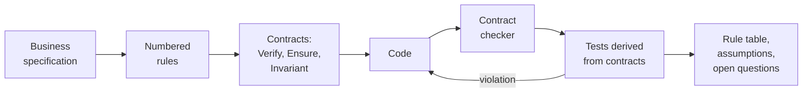

<div align="center">

# PhpDeal

**AI Design by Contract for PHP**

Your AI agent turns business specifications into code that checks its own rules.<br>
PhpDeal enforces those rules on every call, as native PHP attributes powered by [Go! AOP](https://github.com/goaop/framework).

[](https://github.com/php-deal/framework/actions/workflows/ci.yml)
[](https://packagist.org/packages/php-deal/framework)
[](https://packagist.org/packages/php-deal/framework)
[](https://www.php.net/releases/8.4/)
[](skills/design-by-contract/SKILL.md)
[](https://github.com/goaop/framework)
[](https://phpstan.org/user-guide/rule-levels)
[](LICENSE)

</div>

You write the rules in plain language:

> **R1.** A deposit is a positive amount.<br>
> **R2.** A deposit adds the amount to the balance.<br>
> **R3.** The balance is never negative.

Your agent turns them into contracts, the code and the tests:

```php
use PhpDeal\Attribute\{Ensure, Invariant, Verify};

#[Invariant('$this->balance >= 0')]                           // R3
class Account
{
    private float $balance = 0.0;

    #[Verify('$amount > 0')]                                   // R1
    #[Ensure('$this->balance === $__old->balance + $amount')] // R2
    public function deposit(float $amount): void
    {
        $this->balance += $amount;
    }
}
```

When the code or its caller breaks a rule, PhpDeal stops the call and names the rule:

```php
new Account()->deposit(-10);
// PhpDeal\Exception\PreconditionViolation:
// Precondition "$amount > 0" violated in Account->deposit(-10.0)
```

## Contents

- [Why AI Design by Contract?](#why-ai-design-by-contract)
- [How it works](#how-it-works)
- [Quick start](#quick-start)
- [What the agent delivers](#what-the-agent-delivers)
- [The contract checker](#the-contract-checker)
- [Features](#features)
- **The contract language**
  - [Setup](#setup)
  - [Contracts](#contracts): [`#[Verify]`](#preconditions-verify), [`#[Ensure]`](#postconditions-ensure),
    [`#[Invariant]`](#invariants-invariant), [`#[Inherit]`](#inheritance-inherit)
  - [Writing expressions](#writing-expressions)
  - [Handling violations](#handling-violations)
  - [PHPStan integration](#phpstan-integration)
  - [Production](#production)
- [Upgrading from 1.x](#upgrading-from-1x)
- [Contributing](#contributing)

## Why AI Design by Contract?

An AI agent writes code faster than anyone can review it. The hard question is no longer *how* to implement a
feature but *whether the code does what the business asked*. The usual answers fall short:

- **Review** does not scale to every line an agent writes.
- **Tests written by the same agent** share its reading of the requirements. When the agent misreads a rule, the
  code and the tests agree with each other, and both are wrong.
- **Requirements in a ticket** are forgotten by the next change, whether a person or an agent makes it.

[Design by Contract](https://en.wikipedia.org/wiki/Design_by_contract) closes that gap. Every business rule becomes
an executable contract that lives next to the code it constrains:

- **Preconditions** (`#[Verify]`) are what the caller must guarantee before a call.
- **Postconditions** (`#[Ensure]`) are what the method promises after it returns.
- **Invariants** (`#[Invariant]`) are what is always true of an object between calls.

PhpDeal checks them on every call. That gives each party something it lacked:

| For...           | Contracts give you                                                                                         |
|------------------|------------------------------------------------------------------------------------------------------------|
| **You**          | A one-line, reviewable statement of each rule, traced to the specification, instead of hundreds of lines of code |
| **The agent**    | An immediate, exact signal: which rule broke, in which method, with which arguments. It fixes the code instead of guessing |
| **The tests**    | An oracle on every call. Any test that drives the object through valid calls also checks every postcondition and invariant |
| **The next change** | Rules that stay enforced. A later edit, by a person or an agent, can not quietly break one |

A broken contract is a bug, reported at the exact place where it happens, before a corrupt state travels through
the application.

## How it works

PhpDeal ships an [Agent Skill](https://agentskills.io), [`design-by-contract`](skills/design-by-contract/SKILL.md),
that teaches your coding agent the whole workflow:



1. **Extract the rules.** The agent reads the specification, numbers every rule (`R1`, `R2`, ...), and writes down
   ambiguities as open questions instead of guessing.
2. **Classify them.** Each rule becomes a precondition, a postcondition or an invariant. A business error that users
   see, such as *"this room is already booked"*, stays as explicit code, because contracts are usually off in
   production.
3. **Write the code** with the contracts on the classes and interfaces, each one tagged with its rule ID.
4. **Check the contracts.** A bundled checker finds mistakes inside the contract strings, which neither PHP nor
   PHPStan see.
5. **Derive the tests.** These cover the examples of the specification, the boundaries of every precondition,
   the business errors, and random sequences of valid calls sampled from the preconditions. The contracts judge
   every step.
6. **Report.** The agent ends with a table that maps each rule to its contract, its code and its test, plus the
   assumptions it made and the questions for the business.

## Quick start

**1. Install the library** (PHP 8.4+):

```bash
composer require php-deal/framework
```

**2. Start the contract kernel** in your test bootstrap (and in development), before your classes are loaded. See
[Setup](#setup) for all options:

```php
use PhpDeal\ContractApplication;

require __DIR__ . '/../vendor/autoload.php';

ContractApplication::getInstance()->init([
    'debug'        => true,
    'appDir'       => __DIR__ . '/..',
    'cacheDir'     => __DIR__ . '/../var/cache/contracts',
    'includePaths' => [__DIR__ . '/../src'],
]);
```

**3. Give your agent the skill.** In [Claude Code](https://claude.com/claude-code), install the plugin from this
repository:

```
/plugin marketplace add php-deal/framework
/plugin install php-deal@php-deal
```

Other agents that read the [Agent Skills](https://agentskills.io) format can load the folder
[`skills/design-by-contract`](skills/design-by-contract) directly. Composer installs it too, at
`vendor/php-deal/framework/skills/design-by-contract`, in the version that matches your library.

**4. Hand over the specification:**

> Implement docs/booking-spec.md with Design by Contract, and write the tests.

In Claude Code you can also call the skill explicitly with `/php-deal:design-by-contract`.

## What the agent delivers

The [worked example](skills/design-by-contract/examples/inventory) shows a complete run. Our CI weaves and runs it on
every change:

- [`SPEC.md`](skills/design-by-contract/examples/inventory/SPEC.md): nine stock-keeping rules, written for people;
- [`StockItem.php`](skills/design-by-contract/examples/inventory/StockItem.php): the class, with each contract
  tagged by its rule;
- [`StockItemTest.php`](skills/design-by-contract/examples/inventory/StockItemTest.php): the tests derived from the
  rules and the contracts;
- a rule table:

| Rule | Contract or code                                                           | Where                      | Test                                      |
|------|----------------------------------------------------------------------------|----------------------------|-------------------------------------------|
| R3   | `#[Invariant('$this->reserved >= 0 && $this->reserved <= $this->onHand')]` | `StockItem`                | random sequences                          |
| R6   | `#[Verify('$quantity <= $this->available()')]`                             | `StockItem::reserve()`     | precondition boundaries                   |
| R8   | `#[Ensure('$this->onHand === $__old->onHand - $quantity')]`                | `StockItem::ship()`        | specification example, random sequences   |
| R9   | code: throws `CountBelowReserved`, a business error                        | `StockItem::recordCount()` | `testCountBelowTheReservationsIsRejected` |

The random sequences are contract-based testing with no extra library. The agent samples valid arguments from the
preconditions, and every postcondition and invariant checks every step:

```php
$random = new Randomizer(new Mt19937($seed));
for ($step = 0; $step < 200; ++$step) {
    if ($item->available() > 0) {
        $item->reserve($random->getInt(1, $item->available())); // sampled from #[Verify]
    }
    $item->receive($random->getInt(1, 50));
}
```

**Does it catch bugs?** We gave an agent with no other context a new specification (meeting-room booking) and only
the skill. It wrote 46 contracts and 46 tests. Then it planted five bugs, one at a time: an off-by-one error, a wrong
overlap check, a cancel that deleted every booking, reused ids and a broken free-slot check. Contracts caught all
five.

## The contract checker

Contracts are PHP expressions in strings, so neither PHP nor PHPStan see their mistakes until the method runs. The
skill bundles a checker that agents run after every edit. You can run it too, in CI or by hand:

```bash
php vendor/php-deal/framework/skills/design-by-contract/scripts/lint-contracts.php --strict src
```

It reports syntax errors, misspelled variables, `$__old` or `$__result` in the wrong contract, `$this` in static
methods, class names that `use` imports do not resolve, double-quoted strings, assignments, reads of the clock or
random values, and `\in_array()` without strict comparison.

## Features

**For AI-driven development**

- 🤖 **Agent Skill** with the full workflow from specification to tested code, installable as a Claude Code plugin
  and portable to any agent that reads the Agent Skills format.
- 🧭 **Traceable rules**: every contract carries the ID of the business rule it enforces.
- 🧪 **Tests derived from contracts**: specification examples, precondition boundaries, business errors and seeded
  random sequences.
- 🔎 **Contract checker** that catches mistakes in expressions before they run.
- 🎯 **Exact feedback**: a violation names the contract, the class, the method and the arguments, and points to the
  declaring line, so the agent fixes the right place.

**The contract engine**

- ✅ **Native PHP attributes**: `#[Verify]`, `#[Ensure]`, `#[Invariant]` and `#[Inherit]`, repeatable where it makes sense.
- 🧬 **Contract inheritance** from parent classes and interfaces, with clear and predictable rules.
- 🔒 **Full access to the object**: expressions run in the scope of the class and can read private state.
- 🕰️ **`$__old` and `$__result`** to compare the state before and after a call, and to check return values.
- ⚡ **Fast**: each expression is compiled once, contracts are read once per class, and the object is cloned only when
  a contract uses `$__old`.
- 🔁 **Recursion-safe**: an invariant may call public methods of its own class.
- 🧩 **Works with assertion libraries** such as [beberlei/assert](https://github.com/beberlei/assert).
- 🔍 **PHPStan extension** included: properties and methods used only by contracts are not reported as unused.
- 🧪 **Thoroughly tested**, analysed with PHPStan at level 10 with strict rules.

---

# The contract language

The rest of this document is the reference for the contracts themselves: what your agent writes and what you
review. Everything in it works without an AI as well, and contracts can be written by hand.

## Setup

PhpDeal 2 requires **PHP 8.4** or newer and is built on **Go! AOP 4 or 5** (Go! AOP 5 needs PHP 8.5; Composer picks
the version that fits your PHP). Contracts are checked only in classes that Go! AOP weaves, so the kernel must start
before they are loaded.

Initialize the contract kernel once, as early as possible in your front controller or test bootstrap, before the
classes with contracts are loaded:

```php
use PhpDeal\ContractApplication;

require __DIR__ . '/../vendor/autoload.php';

ContractApplication::getInstance()->init([
    'debug'        => true,
    'appDir'       => __DIR__ . '/..',
    'cacheDir'     => __DIR__ . '/../var/cache/contracts',
    'includePaths' => [__DIR__ . '/../src'],
]);
```

| Option         | Purpose                                                                                     |
|----------------|---------------------------------------------------------------------------------------------|
| `debug`        | `true` during development: changed classes are woven again automatically.                  |
| `appDir`       | Root directory of the application, usually the directory that contains `vendor/`.          |
| `cacheDir`     | Writable directory for the woven classes.                                                    |
| `includePaths` | Directories with the classes that declare contracts. Keep it narrow, it speeds up weaving. |
| `excludePaths` | Directories that are never woven.                                                            |

All [Go! AOP kernel options](https://github.com/goaop/framework/blob/master/docs/configuration.md) are supported.

### Already using Go! AOP?

Go! AOP runs a single kernel per application. Register the contract aspects in your own kernel instead of starting
`ContractApplication`:

```php
use Go\Core\AspectContainer;
use Go\Core\AspectKernel;
use PhpDeal\ContractApplication;

final class ApplicationAspectKernel extends AspectKernel
{
    protected function configureAop(AspectContainer $container): void
    {
        ContractApplication::registerAspects($container);
        // ...your own aspects
    }
}
```

### Symfony

Initialize the kernel in `public/index.php` (and in `tests/bootstrap.php`) right after the Composer autoloader, and
point `includePaths` to the `src` directory, not to the document root:

```php
ContractApplication::getInstance()->init([
    'debug'        => $_SERVER['APP_DEBUG'] ?? false,
    'appDir'       => dirname(__DIR__),
    'cacheDir'     => dirname(__DIR__) . '/var/cache/contracts',
    'includePaths' => [dirname(__DIR__) . '/src'],
]);
```

## Contracts

| Attribute      | Target           | Checked                                    | Extra variables          | Inherited from parents |
|----------------|------------------|--------------------------------------------|--------------------------|------------------------|
| `#[Verify]`    | method           | before the method body                     | –                        | on request             |
| `#[Ensure]`    | method           | after the method returns                   | `$__result`, `$__old`    | always                 |
| `#[Invariant]` | class, interface | after the constructor and every public method | `$__result`           | always                 |
| `#[Inherit]`   | method, class    | enables the contracts of parents           | –                        | –                      |

Method arguments are available in every expression by their names, default values included. A variadic parameter is
a list of the passed values.

### Preconditions: `#[Verify]`

A precondition is a requirement upon the caller. It is checked before the method body runs, so the body never sees
invalid arguments:

```php
use PhpDeal\Attribute\Verify;

class Wallet
{
    private const array SUPPORTED = ['EUR', 'USD'];

    private float $balance = 100.0;

    #[Verify('$amount > 0')]
    #[Verify('$amount <= $this->balance')]
    public function withdraw(float $amount): void
    {
        $this->balance -= $amount;
    }

    #[Verify('\in_array($currency, self::SUPPORTED, true)')]
    public static function convert(float $amount, string $currency = 'EUR'): float
    {
        return $amount; // static methods are supported as well
    }
}
```

The attribute is repeatable: every expression must hold.

### Postconditions: `#[Ensure]`

A postcondition is a promise of the method. It is checked after the method returns. Two extra variables are
available:

- `$__result` holds the value returned by the method;
- `$__old` is a clone of the object taken right before the call, to compare the state before and after.

```php
use PhpDeal\Attribute\Ensure;

class Counter
{
    private int $value = 0;

    #[Ensure('$this->value === $__old->value + 1')]
    public function increment(): void
    {
        ++$this->value;
    }

    #[Ensure('$__result >= 0')]
    public function getValue(): int
    {
        return $this->value;
    }
}
```

The object is cloned only when a contract of the method mentions `$__old`, and only when the class can be cloned.

### Invariants: `#[Invariant]`

An invariant describes a property of the object that holds whenever it is observed from the outside. It is checked
after the constructor and after every public method:

```php
use PhpDeal\Attribute\Invariant;

#[Invariant('$this->speed >= 0')]
#[Invariant('$this->speed < 299_792_458')] // not faster than light
class Particle
{
    public function __construct(private float $speed = 0) {}

    public function accelerate(float $acceleration, float $time): void
    {
        $this->speed += $acceleration * $time;
    }
}
```

Invariants of parent classes and interfaces always apply. An invariant can call public methods of its own class
without checking the invariant again.

### Inheritance: `#[Inherit]`

Contracts follow the class hierarchy, so an implementation can not quietly break the promises of its interface:

| Contract       | Inherited from parent classes and interfaces                                           |
|----------------|-----------------------------------------------------------------------------------------|
| `#[Ensure]`    | Always, when the method declares a postcondition itself or uses `#[Inherit]`            |
| `#[Invariant]` | Always, when the class declares an invariant itself or uses `#[Inherit]`                |
| `#[Verify]`    | Only on request: with `#[Inherit]`, or with an `{@inheritdoc}` tag in the doc comment   |

Preconditions are opt-in because a subclass may accept more than its parent (Liskov: *require no more, promise no
less*).

Use `#[Inherit]` to take over the contracts of the parents without declaring any of your own. On a method it enables
the preconditions and postconditions of the same method in every parent class and interface. On a class it does the
same for every public method and enables the invariants of the parents:

```php
use PhpDeal\Attribute\{Ensure, Inherit, Invariant, Verify};

#[Invariant('$this->getBalance() >= 0')]
interface AccountContract
{
    #[Verify('$amount > 0')]
    #[Ensure('$this->getBalance() === $__old->getBalance() + $amount')]
    public function deposit(float $amount): void;

    public function getBalance(): float;
}

#[Inherit] // every contract of AccountContract applies to this class
class Account implements AccountContract
{
    private float $balance = 0.0;

    public function deposit(float $amount): void
    {
        $this->balance += $amount;
    }

    public function getBalance(): float
    {
        return $this->balance;
    }
}
```

All the contracts that apply to a call must hold. A class without any contract attribute, and without
`#[Inherit]`, is not checked even if its interfaces declare contracts.

## Writing expressions

A contract is a PHP expression in a string. It must return `true` when the contract holds and `false` when it is
violated. Returning `null` is accepted too, for assertion helpers that return nothing.

- **Scope.** The expression runs in the scope of the class that declares it, so it can read private and protected
  members with `$this->`, `self::` and `static::`. Contracts of an interface run in the scope of the implementing
  class. Static methods have no `$this`.
- **Names.** The expression is compiled outside of your file, so `use` imports do not apply: write class and function
  names fully qualified, e.g. `'\App\Money::isValid($amount)'` or `'Assert\Assertion::email($email)'`.
- **Errors.** An error or exception thrown by the expression is reported as a violation of the contract, with the
  original error as the previous exception. Assertion libraries can be used that way:

```php
#[Verify('Assert\Assertion::between($percent, 0, 100)')]
public function setDiscount(int $percent): void {}
```

- **Mistakes in contracts.** A syntax error, a `$this` in a static method or a result that is neither a boolean nor
  `null` throws an `InvalidContractException`: this is a bug in the contract itself, not a violation of it.

## Handling violations

Every exception of PhpDeal implements `PhpDeal\Exception\ExceptionInterface`:

```
ExceptionInterface
├── ContractViolation (LogicException)        a contract does not hold
│   ├── PreconditionViolation                 #[Verify]: the caller passed invalid arguments
│   ├── PostconditionViolation                #[Ensure]: the method did not keep its promise
│   └── InvariantViolation                    #[Invariant]: the object is in an invalid state
└── InvalidContractException (DomainException) the contract itself is broken
```

A violation tells exactly what went wrong and where. Its file and line point to the method that declares the contract:

```php
try {
    $account->withdraw(70);
} catch (PreconditionViolation $violation) {
    $violation->getMessage();  // Precondition "$amount > 0 && $amount <= 50" violated in Demo\Account->withdraw(70.0)
    $violation->contract;      // '$amount > 0 && $amount <= 50'
    $violation->className;     // 'Demo\Account'
    $violation->methodName;    // 'withdraw'
    $violation->getPrevious(); // the assertion exception or error raised by the expression, if any
}
```

Arguments in the message are rendered safely: long strings are truncated, and arrays and objects are reduced to their
size and class.

## PHPStan integration

Contract expressions are strings, so PHPStan can not see that a private property or method is used by a contract and
reports it as unused. PhpDeal ships a PHPStan extension that fixes this. With
[phpstan/extension-installer](https://github.com/phpstan/extension-installer) it is enabled automatically, otherwise
include it in your `phpstan.neon`:

```neon
includes:
    - vendor/php-deal/framework/extension.neon
```

## Production

Contracts are a development and testing tool: every checked call costs an expression evaluation. The usual setup is
to initialize `ContractApplication` only in development and test environments:

```php
if (($_SERVER['APP_ENV'] ?? 'prod') !== 'prod') {
    ContractApplication::getInstance()->init([/* ... */]);
}
```

Without the kernel the attributes are plain metadata, and your classes run untouched. If you keep contracts in
production, set `'debug' => false` and warm up the cache at deploy time, see the
[Go! AOP deployment guide](https://github.com/goaop/framework/blob/master/docs/configuration.md).

## Upgrading from 1.x

PhpDeal 2 replaces Doctrine annotations with native attributes. In short:

```diff
-use PhpDeal\Annotation as Contract;
+use PhpDeal\Attribute as Contract;

-/**
- * @Contract\Verify("$amount > 0 && is_numeric($amount)")
- * @Contract\Ensure("$this->balance == $__old->balance + $amount")
- */
+#[Contract\Verify('$amount > 0 && is_numeric($amount)')]
+#[Contract\Ensure('$this->balance == $__old->balance + $amount')]
 public function deposit($amount)
```

See [UPGRADE-2.0.md](UPGRADE-2.0.md) for every change, and the [CHANGELOG](CHANGELOG.md) for the new features.

## Demo

A small runnable example lives in [`demo/`](demo):

```bash
composer demo
```

## Contributing

Pull requests are welcome! Run `composer test` before submitting: it checks the coding style, runs PHPStan at
level 10 and the test suite. See [CONTRIBUTING.md](CONTRIBUTING.md) for details.

## License

PhpDeal is open-source software licensed under the [MIT license](LICENSE).
